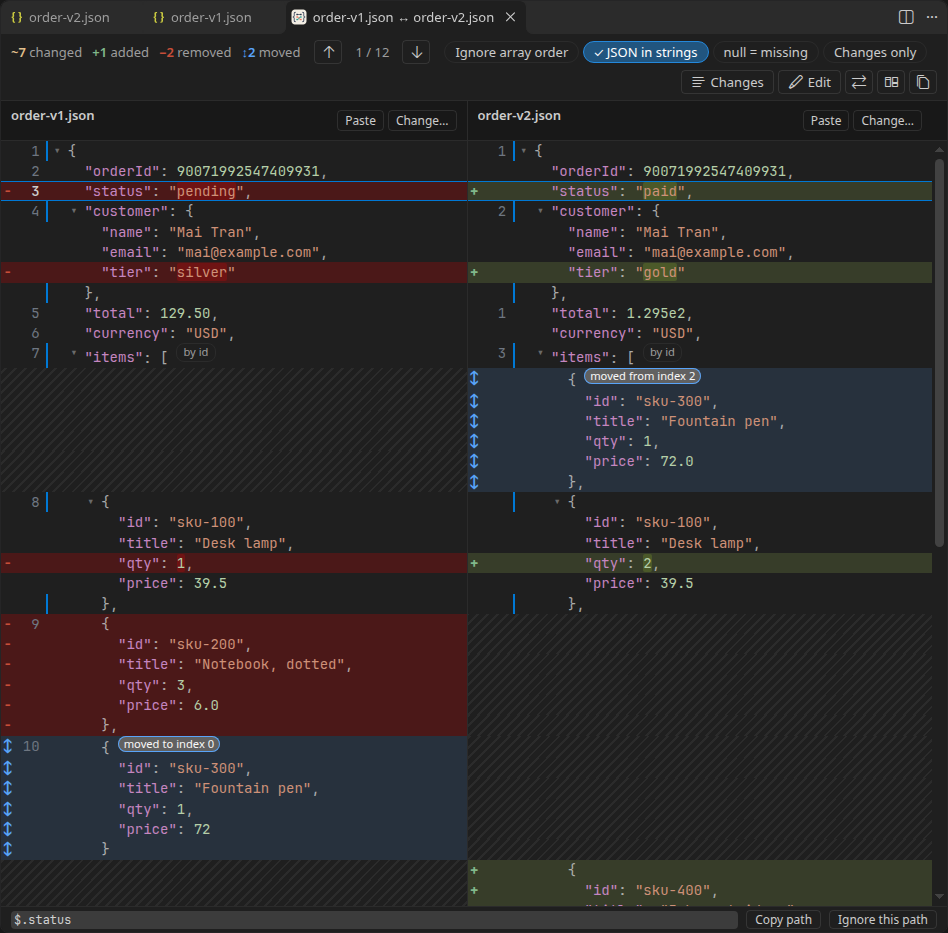
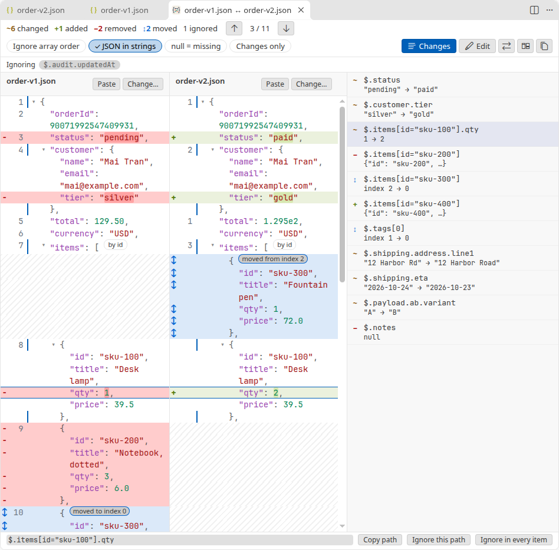
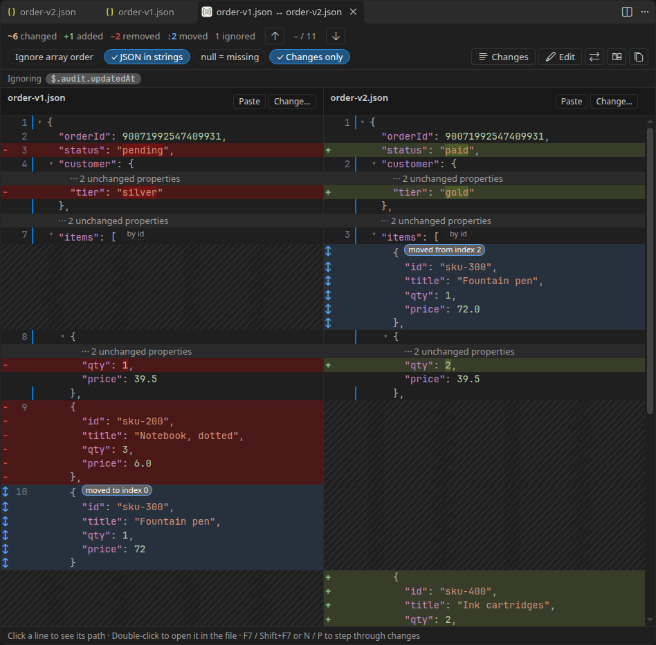

<h1 align="center">
  <br>
  JSON Semantic Diff
</h1>

<p align="center">
  Compare two JSON documents by what they mean, not how they are written.
</p>

<p align="center">
  <a href="https://github.com/heyliamme/json-semantic-diff/blob/main/CHANGELOG.md">Changelog</a> ·
  <a href="https://github.com/heyliamme/json-semantic-diff/blob/main/CONTRIBUTING.md">Contributing</a>
</p>



A text diff of two JSON files is mostly noise: a reordered key, a minified line or
`1.0` against `1` all show up as changes. Sorting keys and formatting both sides first
helps until you reach an array, where one inserted item makes everything after it look
changed. This extension reads both documents and compares the values:

- **Key order, whitespace and number spelling don't matter.** `{"a":1,"b":2}` equals
  `{ b: 2, a: 1.0 }`.
- **Array items are matched by identity.** Objects with an `id` (or `_id`, `uuid`,
  `key`, `name`; configurable) are paired by it, so an insertion doesn't make every
  following item look changed. Items that only changed place are marked as moved.
- **Side by side, lined up.** Each change sits across from its counterpart, with blank
  space where one side has nothing. Each column holds exactly its own document, with
  keys in a shared order so they line up, and the line numbers are the file's own.
- **JSON inside strings is compared as JSON.** `"payload": "{\"a\":1}"` from a log or a
  message queue is opened up and diffed property by property.
- **Paste whatever you have.** Comments, trailing commas, single quotes, unquoted keys,
  a JSON document escaped inside a string, JSON Lines, or a log line with the JSON in
  the middle. A note in the column head says how the input was read.

## Install

From the [Visual Studio Marketplace](https://marketplace.visualstudio.com/items?itemName=heyliam.json-semantic-diff),
from [Open VSX](https://open-vsx.org/extension/heyliam/json-semantic-diff) (VSCodium, Cursor
and other editors), or from a terminal:

```bash
code --install-extension heyliam.json-semantic-diff
```

## Getting started

Open a JSON file and press <kbd>Ctrl</kbd>+<kbd>K</kbd> <kbd>J</kbd>
(<kbd>Cmd</kbd>+<kbd>K</kbd> <kbd>J</kbd> on macOS), then choose what to compare it with:
another open file, a file on disk, or the clipboard.

| To compare | Do this |
| --- | --- |
| The current file with another one | <kbd>Ctrl</kbd>+<kbd>K</kbd> <kbd>J</kbd>, or **Compare with…** in the editor's context menu |
| The current file, or the selection, with the clipboard | <kbd>Ctrl</kbd>+<kbd>K</kbd> <kbd>Shift</kbd>+<kbd>J</kbd> |
| Two files in the Explorer | Select both, right-click, **Compare as JSON** |
| Two files, one at a time | **Select for JSON Compare** on the first, **Compare as JSON with Selected** on the second |
| Your working copy with the last commit | **Compare with HEAD** |
| The two sides of a diff editor (Source Control, a pull request, Timeline) | <kbd>Ctrl</kbd>+<kbd>K</kbd> <kbd>J</kbd>, or the `{}` button in the editor title |
| Two snippets you paste | <kbd>Ctrl</kbd>+<kbd>K</kbd> <kbd>Alt</kbd>+<kbd>J</kbd> (**New Empty Comparison**) |

All commands are under **JSON Semantic Diff** in the Command Palette. To change a
shortcut, search for `jsonSemanticDiff` in **Keyboard Shortcuts**.

## In the comparison



- **Step through changes** with the arrows, <kbd>F7</kbd> / <kbd>Shift</kbd>+<kbd>F7</kbd>,
  or <kbd>N</kbd> / <kbd>P</kbd>. **Changes** lists them all with their paths.
- **Click a line** to see its path and copy it. Items of an array matched by a key are
  named by it, `$.containers[name="app"].image`; others by their index on the right.
  **Double-click** to jump to that line in the file.
- **Fold** any object or array with its arrow. Long unchanged ones start folded, and
  **Changes only** hides everything that didn't change.
- **Ignore this path** hides noise such as timestamps and request ids (**Ignore in every
  item** does it for the same property in all items of an array); **Save to
  settings** keeps it for next time.
- **Ignore array order** treats arrays as sets. **null = missing** treats `"a": null`
  as if `a` were absent.
- **Edit** both sides in place to try something out, **Paste** to replace a side with
  the clipboard, **⇄** to swap sides.
- **Text diff** opens both documents normalized (sorted keys, same layout) in VS Code's
  own diff editor.
- **Copy summary** puts the list of changes on the clipboard as Markdown, ready for a
  pull request or a ticket.

The view follows the files: edit or save either one and the comparison updates.



## Settings

| Setting | Default | |
| --- | --- | --- |
| `jsonSemanticDiff.arrayMatchKeys` | `["id", "_id", "uuid", "key", "name"]` | Properties that identify array items, tried in order. One is used only if every item on both sides has it, as a plain value, unique on its side. |
| `jsonSemanticDiff.ignoreArrayOrder` | `false` | Treat every array as a set. |
| `jsonSemanticDiff.parseNestedJson` | `true` | Compare strings that hold JSON as the JSON inside them. |
| `jsonSemanticDiff.nullEqualsMissing` | `false` | A property set to `null` equals a missing one. |
| `jsonSemanticDiff.ignorePaths` | `[]` | Paths to ignore, see below. |
| `jsonSemanticDiff.changesOnly` | `false` | Start with unchanged content hidden. |
| `jsonSemanticDiff.foldUnchangedAfterLines` | `40` | Unchanged objects and arrays longer than this start folded. |

### Ignore paths

```jsonc
"jsonSemanticDiff.ignorePaths": [
  "$.meta.requestId",   // exactly this path
  "updatedAt",          // a property with this name, at any depth
  "$.items[*].etag",    // * or [*]: any one key or index
  "$.containers[name=\"app\"].env", // an item matched by a key
  "$.**.trace"          // ** (or ..): any number of levels
]
```

Ignored differences stay visible, dimmed, and are left out of the count.

## How it decides what changed

- Objects are compared key by key; the order of keys never matters.
- Numbers are compared by value, exactly: `1`, `1.0` and `1e0` are equal, and large
  integers such as `90071992547409931` are compared digit for digit, not rounded.
- In arrays of objects with a usable match key, items are paired by that key.
  Otherwise the longest run of identical items is kept in place, and what's left is
  paired by similarity: a slightly edited object is shown as modified, not as removed
  and added.
- An item that is identical on both sides but in a different place is marked as moved,
  unless **Ignore array order** is on.
- A string that holds JSON is compared as that JSON. If one side has the string and the
  other the plain object, that difference counts as a change too.
- With duplicate keys, the last value wins, as in `JSON.parse`, and a warning says so.
- A document with a syntax error is reported with its line and column, not guessed at.
  Text around JSON (a log prefix) is skipped only when the input doesn't start with
  `{`, `[` or `"`.

## Known limitations

- It opens next to VS Code's diff editor, not in place of it: from a diff, press
  <kbd>Ctrl</kbd>+<kbd>K</kbd> <kbd>J</kbd> or use the `{}` button.
- It compares two documents at a time, and doesn't merge or apply changes. **Edit**
  changes only the copy in the view, never the files.
- JSON Lines files are compared as one array of lines.
- Large documents work but take a moment: two 11 MB files with 50,000 records open in
  about 7 seconds. Only the part of the view on screen is built, so scrolling and
  stepping through changes stay quick after that.

## Privacy

Everything runs locally. The extension makes no network requests and collects no
telemetry. It reads only the documents you choose to compare.

## Requirements

VS Code 1.90 or newer. **Compare with HEAD** uses the built-in Git extension.

## License

[MIT](LICENSE)
